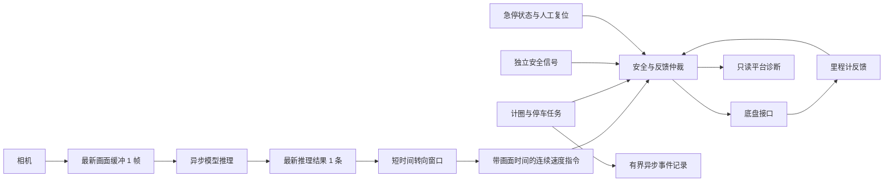

# 视觉导航实时窗口控制架构

目标是让车辆持续使用新鲜画面控制方向，同时让停车、故障和反馈检查优先于速度。参数是联调起点，实际可用速度和停车距离需在赛道上测量。

## 分级缓冲与时效

| 数据 | 缓冲及处理 |
| --- | --- |
| 相机画面 | ROS 2 订阅保留最新一帧；推理线程最多处理一帧，同时等待一帧，新帧覆盖等待中的旧帧。 |
| 模型结果 | 只保留最新一条；发布前再次检查画面时间，统计被新画面覆盖的次数。 |
| 转向窗口 | 默认最多 3 条、250 ms，较新的预测权重更高；仅使用仍在有效期内的画面。窗口可调，0 ms 等于不平滑。 |
| 速度指令 | 默认 10 Hz 连续发布 `TwistStamped`，携带源画面时间；速度和角速度限幅，不排队执行旧动作。 |
| 任务事件 | 256 条有界队列异步写入；队列满、写盘报错或单次写入持续超过 2 秒时，任务进入故障状态。 |

ROS 2 图像使用 `KEEP_LAST=1` 和 best effort，以适配现有相机话题；[ROS 2 Foxy QoS 文档](https://repo.test.ros2.org/en/foxy/Concepts/About-Quality-of-Service-Settings.html)说明了队列深度与发布/订阅配置兼容性。

## 控制优先级和反馈

1. 实体急停和断电能力独立于软件，必须现场确认。软件急停话题默认需要持续的“未按下”心跳；急停、心跳中断后会锁定，需要人工复位。
2. 独立安全信号、任务停车或故障、过期画面/指令、过期里程计都会使仲裁输出零速度。急停和明确停车的回调会尽快发送零指令；最终制动时延还包含 ROS 调度、串口、底盘和机械响应。
3. 里程计监督检查新鲜度与速度限值。发出停车后，如果持续超过配置时间仍未检测到静止，会锁定故障；复位要求新鲜、静止的里程计和有效安全信号。
4. 放行后才输出窗口内最新有效的候选速度。底盘程序的运动入口默认关闭；开启时它还具备软件命令超时归零。底盘固件在进程崩溃、断电或串口故障时能否独立停车尚未确认。

当前还没有接入真实的独立障碍安全监测和实体急停信号源。软件急停不等于实体急停。里程计目前用于监督，不是经过实测整定的速度 PID；挡板绕行也尚未完成。

## 初始参数与时钟

- 相机预览曾配置 10 Hz，模型预览最多 5 Hz，候选速度默认 10 Hz；这些是配置值，不是实测保证。
- 图像最大年龄默认 0.4 秒；候选速度默认 0.05 m/s、角速度限幅 0.4 rad/s。反馈超时默认 0.5 秒，停车确认等待默认 1 秒。这些值需要按真实帧率、车速、车轮反馈和制动距离调整。
- 相机时间戳记录的是程序开始读取相机的时间，包含后续读取和 JPEG 编码；它不是硬件曝光时间。V4L2 相机是否接受单帧缓冲需在车端检查，驱动内部积压仍可能使画面更旧。
- 转向模型历史标签的物理来源和左右方向仍需核实；短窗口和更高频率不能补偿错误模型或错误标定。

## 联调和验证

本机已有线程并发、窗口、过期消息、异常、里程计和急停锁定测试；历史图片加模拟信号的本机回放也已通过。车端 ROS 2 隔离域回放脚本 `tools/steering_gate_smoke.py` 会使用模拟话题，不打开真实底盘。

274 帧历史测试样本（采样间隔中位数 200 ms）的窗口对比中，250 ms 窗口使预测平均变化量从约 0.154 降至 0.133，平均平方误差从约 0.115 降至 0.114；绝对误差的 95 分位则从约 0.760 升至 0.765。该比较故意放宽角速度限幅以单独观察平滑效果，标签单位未核实，不能据此认定实车更稳或更快。完整数据位于 `平台/data/训练结果/vendor-2025-heldout-mps-20261028-1832/window-analysis-20261029-v2.json`，可用 `tools/evaluate_window.py` 对同格式数据重测。

新旧程序的候选话题类型不同：新版本默认 `TwistStamped`，旧版是 `Twist`。部署时需成套更新，不能混用。当前修改尚未部署到小车，也未做车端 ROS 2 回放或实际运动验证。

现场建议顺序：先检查摄像头和左右预测，再核实独立安全、实体急停、底盘失联保护及里程计，架空车轮验证速度方向；随后在有人看护的赛道上逐段低速测试，确认绕挡板、人行道、计圈和停车，最后逐步提高速度并用实际比赛用时与罚时比较。
